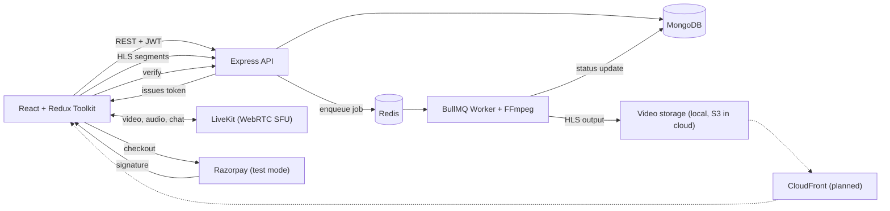
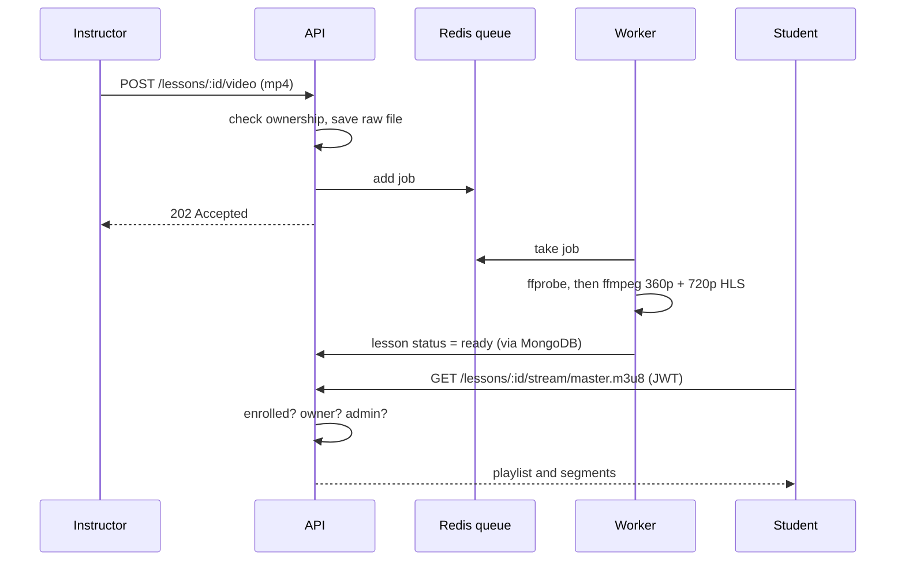
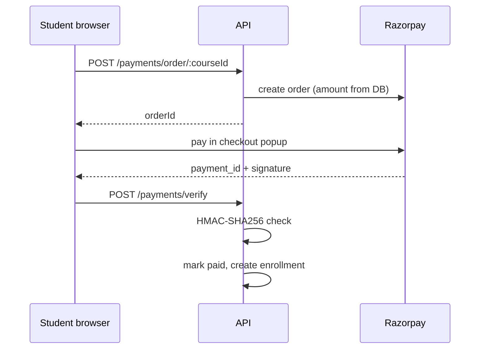

# Architecture

## System overview

## Video pipeline

## Payment flow

## Key design decisions

| Decision | Reason |
|---|---|
| FFmpeg in a BullMQ worker, not in the request | Conversion takes seconds to minutes, the API must stay responsive. Failed jobs retry automatically |
| HLS with 360p and 720p | Player picks quality by network speed |
| Stream route checks enrollment on every segment | Direct file URLs are not public |
| `correctIndex` never sent to students | Answers would be visible in the Network tab |
| Quiz grading on the server | Client cannot fake a score |
| Payment amount read from DB | Client cannot change the price |
| Enrollment only after signature verification | Client "success" is never trusted |
| LiveKit token carries `canPublish` | Only the instructor can broadcast |
| Certificate has public verify URL | Fake certificates can be checked |